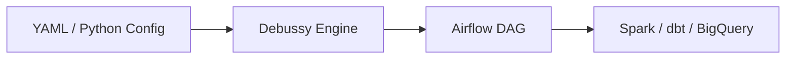

<div align="center">


# Debussy

**Compose data pipelines like music — low-code, self-service, production-ready.**

[](https://pypi.org/project/debussy/)
[](https://pypi.org/project/debussy/#files)
[](https://pypi.org/project/debussy/)
[](https://airflow.apache.org/)
[](https://github.com/debussy-labs/debussy/actions/workflows/ci.yml)
[](https://github.com/debussy-labs/debussy/actions/workflows/release.yml)
[](LICENSE)
[](https://github.com/debussy-labs/debussy/issues)
[](https://github.com/debussy-labs/debussy/stargazers)
[](https://github.com/debussy-labs/debussy/network)
[](https://discord.gg/FpNX79pY)

</div>

<div align="center">

[Description](#description) · [Key Features](#key-features) · [Key Benefits](#key-benefits) · [Quick Start](#quick-start) · [Integrations](#integrations) · [Full Documentation](#full-documentation) · [Communication](#communication) · [Contributions](#contributions) · [Changelog](#changelog) · [License](#license)

</div>

---

## Description

[Debussy](https://github.com/debussy-labs/debussy/wiki) is a free, open-source, opinionated data architecture and engineering framework. It helps data analysts and engineers build better data platforms through first-class, low-code, self-service pipelines.

In data engineering, teams keep reinventing the wheel. Software engineering practices such as [DRY](https://en.wikipedia.org/wiki/Don%27t_repeat_yourself), [KISS](https://en.wikipedia.org/wiki/KISS_principle) and [YAGNI](https://en.wikipedia.org/wiki/You_aren%27t_gonna_need_it) are still rarely adopted, even though orchestration tools (e.g. [Apache Airflow](https://airflow.apache.org/), [Prefect](https://www.prefect.io/), [Dagster](https://dagster.io/)) and distributed processing engines (e.g. [Apache Spark](https://spark.apache.org/), [Apache Beam](https://beam.apache.org/)) abound. Each new pipeline still tends to become a lengthy development project — like building a web application without a framework such as [Django](https://www.djangoproject.com/) or [Flask](https://palletsprojects.com/p/flask/).

Worse, these tools share core concepts but use very different syntaxes and features, which makes migrations daunting. Adopting them also does not automatically produce sound data architecture (data modeling, lifecycle management, and so on). Most companies solve this with in-house frameworks, missing the opportunity for collaboration and wider adoption of data architecture and software engineering best practices.

That is why we built Debussy: a code generation engine for orchestration tools, currently supporting Airflow, with more backends on the roadmap. Its musical semantic model decouples pipeline logic from the orchestration engine and enables a low-code approach. Debussy also ships pipeline templates for ingestion, transformation and reverse ETL, with those best practices built in.

### The semantic model in one minute

Debussy borrows its vocabulary from music so that pipeline structure is easy to reason about:

| Concept | Musical metaphor | What it means in Debussy |
| --- | --- | --- |
| **Composition** | A complete piece | A pipeline configuration: DAG parameters plus the movements to play. It builds one or more DAGs. |
| **Movement** | A self-contained section of a piece | One extraction or transformation unit (for example, one source table), rendered as a task group. |
| **Phrase** | A melodic line within a movement | A sequence of related steps, chained in execution order. |
| **Motif** | A short, recurring musical idea | The smallest reusable building block: a backend-specific task such as a BigQuery load or a dbt run. |



## Key Features

- Generate dynamic pipelines from YAML configuration files or directly in Python.
- Describe pipelines with a semantic model that abstracts the orchestration backend.
- Integrate first-class data projects such as Airflow, Spark and dbt out of the box.
- Keep the core package independent of Airflow; install only the extras your platform needs.

## Key Benefits

&#10004; Shorter delivery time and lower pipeline development cost, with higher ROI <br />
&#10004; Less pipeline debt through sound software engineering design principles <br />
&#10004; Data architecture best practices built into your platform <br />

## Quick Start

Debussy's core requires Python 3.11+. The Airflow backend requires Apache Airflow 3.4+ (`>=3.4,<4`). Since the target lakehouse integrations are currently GCP-based, we recommend deploying to [Cloud Composer](https://cloud.google.com/composer).

To get started:

1. [Select or create a Google Cloud Platform project](https://console.cloud.google.com/cloud-resource-manager).
2. [Enable billing for your project](https://cloud.google.com/billing/docs/how-to/modify-project#enable_billing_for_a_project).
3. [Create a Cloud Composer 3 environment](https://cloud.google.com/composer/docs/composer-3/create-environments) running Airflow 3.
4. Install Debussy on your Cloud Composer instance, with the extras your pipelines need (see [Installation](#installation)).
5. Read the [User's Guide](https://github.com/debussy-labs/debussy/wiki/User's-Guide) and the [examples](https://github.com/debussy-labs/debussy/tree/main/examples) to learn how to use it!

### Installation

The base package (`pip install debussy`) contains only the engine-neutral core and depends on `Inject` and `yaml_env_var_parser`. Everything else is an extra:

| Extra | Adds | Use it for |
| --- | --- | --- |
| `airflow` | The Airflow backend (`debussy.backends.airflow`): Apache Airflow 3.4+ and the standard provider | Every pipeline that generates an Airflow DAG |
| `gcp` | BigQuery, Dataproc and Cloud Storage motifs (the Airflow Google provider) | GCP-based ingestion and transformation |
| `dbt` | `dbt-bigquery` | dbt transformation pipelines |
| `mysql` | `mysqlclient` and `pandas` | Reverse ETL to MySQL |
| `sftp` | `paramiko` | Reverse ETL to SFTP |

All pipelines that ship with Debussy run on Airflow today, so a typical installation is `pip install "debussy[airflow,gcp,dbt]"`, plus `mysql` and `sftp` for the reverse ETL destinations you use.

### Defining pipelines

A pipeline file such as `pipelines/example.yaml` becomes a DAG when it has a top-level `composition_type` key. Here is a real, minimal example from [`examples/data_ingestion/bigquery_ingestion_full/composition.yaml`](examples/data_ingestion/bigquery_ingestion_full/composition.yaml) (the referenced `raw_table_definition` is a separate schema file):

```yaml
composition_type: bigquery_ingestion
name: bigquery_ingestion_full
source_name: example
source_type: bigquery
description: BigQuery ingestion
dag_parameters:
  dag_id: bigquery_ingestion_full
  description: BigQuery full ingestion example. Fixing a partition and always overwriting it. Versioning on storage
  catchup: false
  schedule: "*/30 * * * *" # At every minute.
  start_date: !!timestamp 2022-01-01 00:00:00
  tags:
    - framework:debussy
    - project:example
    - source:bigquery
    - type:ingestion
    - load:full
    - tier:2
  default_args:
    owner: debussy
ingestion_parameters:
  - name: sintetico_full
    raw_table_definition: ${DEBUSSY__DAGS_FOLDER}/examples/data_ingestion/bigquery_ingestion_full/table_def_sintetico_full.yaml
    extraction_query: SELECT 'dado' as data, TIMESTAMP '{{ logical_date }}' as airflow_logical_date
    extract_connection_id: google_cloud_debussy
    data_partitioning:
      gcs_partition_schema: _load_flag=full/_ts_window_start=0001-01-01 00:00:00/_ts_window_end=9999-01-01 00:00:00/_logical_ts=1970-01-01/_ingestion_ts={{ dag_run.start_date }}
      destination_partition: 1970
```

Supported values are `bigquery_ingestion`, `rdbms_ingestion`, `dbt_transformation`, `reverse_etl_bigquery_to_mysql` and `reverse_etl_bigquery_to_storage`. Other YAML files, such as table schemas, are ignored. Add `os_env_prefix: MY_PIPELINE` if the YAML references `${MY_PIPELINE_WINDOW_START}` and `${MY_PIPELINE_WINDOW_END}` (see [`composition_daily.yaml`](examples/data_ingestion/mysql_sakila_ingestion/composition_daily.yaml)). Relative paths are resolved against Airflow's `dags_folder`.

Add one loader file to the Airflow DAGs folder; it generates one DAG per pipeline. This is the exact [`examples/dags.py`](examples/dags.py) loader:

```python
from debussy.backends.airflow import load_dags

load_dags(
    globals(),
    pipelines_dir="examples",
    environment_file="examples/environment.yaml",
)
```

For your own pipelines, point `pipelines_dir` at your folder (for example, `"pipelines"`) and `environment_file` at your environment file.

The Python API works the same way: build the config objects and pass them to `load_dags(globals(), pipelines=[config])`. Abridged from [`mysql_sakila_ingestion_yamless.py`](examples/data_ingestion/mysql_sakila_ingestion/mysql_sakila_ingestion_yamless.py):

```python
import datetime as dt

from debussy.backends.airflow import load_dags
from debussy.core.config.config_dag_parameters import ConfigDagParameters
from debussy.core.config.config_environment import ConfigEnvironment
from debussy.pipeline.data_ingestion.config.movement_parameters.rdbms_data_ingestion import (
    RdbmsDataIngestionMovementParameters,
)
from debussy.pipeline.data_ingestion.config.rdbms_data_ingestion import (
    ConfigRdbmsDataIngestion,
)

environment = ConfigEnvironment.load_from_file("examples/environment.yaml")
dag_parameters = ConfigDagParameters(
    dag_id="mysql_sakila_ingestion_yamless",
    description="MySQL ingestion example from the Sakila sample database",
    start_date=dt.datetime(2006, 2, 15),
    catchup=True,
    schedule="@daily",
)
composition = ConfigRdbmsDataIngestion(
    name="mysql_sakila_ingestion_yamless",
    description="MySQL ingestion without YAML",
    source_type="mysql",
    source_name="sakila",
    secret_manager_uri=f"projects/{environment.project}/secrets/debussy_mysql_dev",
    dataproc_config={"machine_type": "n1-standard-2", "num_workers": 0},
    environment=environment,
    dag_parameters=dag_parameters,
    movements_parameters=[
        RdbmsDataIngestionMovementParameters(
            name="category",
            extract_connection_id="google_cloud_debussy",
            extraction_query="SELECT category_id, name, last_update FROM sakila.category",
            raw_table_definition={
                "fields": [
                    {"name": "category_id", "data_type": "INT64"},
                    {"name": "name", "data_type": "STRING"},
                    {"name": "last_update", "data_type": "TIMESTAMP"},
                ]
            },
            data_partitioning={
                "gcs_partition_schema": "_load_flag=incr/_logical_ts={{ logical_date }}",
                "destination_partition": "{{ logical_date.strftime('%Y%m%d') }}",
            },
        )
    ],
)

load_dags(globals(), pipelines=[composition])
```

<details>
<summary>Migrating from debussy_concert 1.x</summary>

The package is now `debussy` and Airflow is no longer a mandatory dependency. Change imports from `debussy_concert` to `debussy`. `airflow_easy_setup` is gone: delete the per-pipeline setup `.py` files, add `composition_type` (and `os_env_prefix`, if you had one) to each composition YAML, and add the `load_dags` file above. The `debussy_airflow` package is no longer needed. Airflow 2 users should stay on `debussy_concert<2`.

</details>

## Integrations

Debussy works with the tools and systems you already use with your data. Badges below are standardized [shields.io](https://shields.io/) badges, replacing heavyweight external logo images:

| Category | Integration | Notes |
| --- | --- | --- |
| Orchestration |  | An open-source orchestration engine ([airflow.apache.org](https://airflow.apache.org/)) |
| Processing & Transformation |  | Open-source distributed processing engine, used for ingestion pipelines ([spark.apache.org](https://spark.apache.org/)) |
| Processing & Transformation |  | Open-source transformation tool, used for transformation pipelines |
| Storage & Data Warehouse |  | Cloud blob storage, supported as a data source or destination |
| Storage & Data Warehouse |  | Serverless, massive-scale SQL analytics platform; the analytical environment (aka data lakehouse) |
| Storage & Data Warehouse |  | Cloud blob storage, supported as a data source or destination |
| Relational Databases |  | Leading open-source database, supported as a data source or destination |
| Relational Databases |  | Leading open-source database, supported as a data source or destination |
| Relational Databases |  | Most RDBMS are supported as data sources via JDBC drivers through Spark |

## Full Documentation

See the [Wiki](https://github.com/debussy-labs/debussy/wiki) for full documentation, examples, operational details and more.

## Communication

- [GitHub Issues](https://github.com/debussy-labs/debussy/issues)
- [Discord Server](https://discord.gg/FpNX79pY) ([community guidelines](docs/discord_guidelines.md))

## Contributions

We welcome all community contributions!

To keep the community open and welcoming, Debussy adheres to a [code of conduct](https://github.com/debussy-labs/debussy/wiki/Code-of-Conduct) adapted from the Contributor Covenant.

Please read the [contributing guidelines](https://github.com/debussy-labs/debussy/wiki/Contributing-Guide) before opening an issue or a pull request. They cover issue reporting, coding standards and development setup.

## Changelog

Release notes are maintained in [`CHANGELOG.md`](CHANGELOG.md), in the [Keep a Changelog](https://keepachangelog.com/en/1.1.0/) format. Upgrading from 1.x? Start with its **Breaking changes** section and the [migration guide](docs/migration.md).

- **2.0.0 (unreleased):** package renamed from `debussy_concert` to `debussy` (import `debussy`, environment variable prefix `DEBUSSY__`), Python 3.11+ and Airflow 3.4+, Airflow code moved to `debussy.backends.airflow`, and Airflow/Google Cloud/dbt/MySQL/SFTP dependencies split into extras. `airflow_easy_setup` and per-pipeline setup files are replaced by `load_dags`.
- **1.2.0:** packaging fixes, `airflow_easy_setup` and Dataproc Serverless support.
- **1.1.0:** Dataproc Serverless support and a BigQuery load-with-schema fix.
- **1.0.0:** improved folder structure and dependencies.
- **0.1.0:** first release.

## License

Licensed under the Apache License, Version 2.0 (the "License"); you may not use this file except in compliance with the License. You may obtain a copy of the License at [LICENSE](LICENSE) or at <http://www.apache.org/licenses/LICENSE-2.0>.

Unless required by applicable law or agreed to in writing, software distributed under the License is distributed on an "AS IS" BASIS, WITHOUT WARRANTIES OR CONDITIONS OF ANY KIND, either express or implied. See the License for the specific language governing permissions and limitations under the License.
